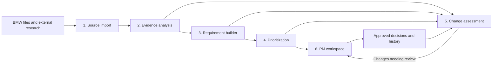

# Implementation plan

Build one application that turns customer evidence into a prioritized list of product requirements and tells PMs when a decision needs revisiting.

Start with **G60 / US**, while carrying vehicle and market through every component.

## Components and connections

The application has six components and a shared data store. Every requirement, priority, and decision remains connected to its supporting evidence.

All components use the same source references, requirement IDs, and versions. They can be modules within one backend; they do not need separate services.

| Component | What it does | What it passes onward |
| --- | --- | --- |
| **1. Source import** | Reads spreadsheets, PDFs, and selected web sources. Preserves originals, identifies duplicates, and records exact source locations. | Searchable source records, including vehicle, market, and available dates. |
| **2. Evidence analysis** | Uses AI to identify customer needs, positive attributes, problems, and relevant context. Connects related findings and identifies supporting or conflicting evidence. | Structured findings linked to original records. |
| **3. Requirement builder** | Consolidates findings into clear customer-facing requirements with scope, acceptance criteria, and assumptions. Maintains stable identities as requirements evolve. | Draft requirement versions and their evidence links. |
| **4. Prioritization** | Applies an explicit scoring rubric to the findings and requirements. Produces an understandable explanation of each priority. | A ranked list with recorded scoring inputs and results. |
| **5. Change assessment** | Compares updated evidence, requirements, and priorities against the last approved state. Determines which changes warrant attention. | Review items explaining what changed, why it matters, and the suggested response. |
| **6. PM workspace** | Presents the priority list, evidence, and review items. Lets PMs approve, edit, reject, or postpone. | Recorded decisions and newly approved versions. |

## Shared foundation

The shared data store holds source records, findings, requirement versions, priority calculations, review items, and decision history.

The essential connection is:

**Source → finding → requirement version → priority → PM decision**

This connection supports explaining a recommendation, identifying affected decisions when evidence changes, and reconstructing previous decisions.

## Workflows

1. **Initial analysis:** import the BMW data → extract findings → build requirements → calculate priorities → PM reviews and approves.
2. **Ongoing updates:** import new evidence → identify affected requirements → propose revisions and recalculate priorities → assess significance → present relevant changes for PM review.

Approved versions remain intact until the PM accepts a revision. Proposed changes appear alongside the approved version, with a clear explanation. Edits also pass through prioritization so the displayed score matches the actual requirement.

The PM workspace consists of vehicle and market selection, a priority list, the selected requirement's details, and a **Needs review** filter.

## Implementation sequence

1. **Establish the connections:** define the shared records and import BMW data with reliable references.
2. **Complete the initial workflow:** generate requirements, rank them, display evidence, and record decisions.
3. **Complete the update workflow:** detect meaningful changes and support reviewed revisions.
4. **Evaluate and refine:** measure evidence quality, decision time, and change-detection accuracy; improve the interface around those results.

The first milestone is one requirement completing both workflows end to end.
