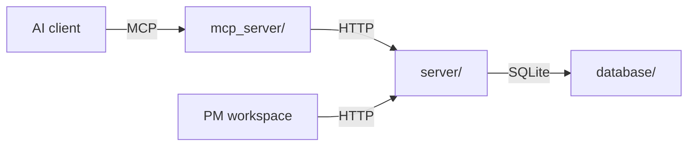
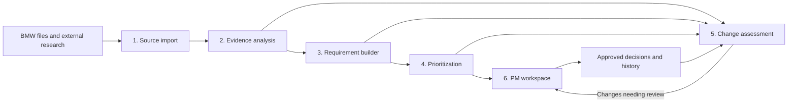

# Implementation plan

Build one application that turns customer evidence into a prioritized list of product requirements and tells PMs when a decision needs revisiting.

Start with **G60 / US**, while carrying vehicle and market through every component.

## Current setup

Docker Compose (`compose.yml`) runs two Python services and keeps the SQLite database in a third folder on the host:

| Folder | Role | Current implementation |
| --- | --- | --- |
| `mcp_server/` | MCP interface for AI clients. It calls the Python API over the Compose network rather than opening the database directly. | Streamable HTTP on port 8001, with `list_sources` and `get_source` tools. |
| `server/` | Ordinary Python/FastAPI server and the application's business logic. It owns validation, workflows, and database access. | HTTP API on port 8000, with a health check and endpoints to create, list, and get source records. |
| `database/` | Shared persistence code, SQLite schema, local database file, and snapshots. | A `sources` table; `database/local/` and `database/snapshots/` are mounted into the API container and persist across rebuilds. |

The database folder is **not a third running service**: SQLite runs inside the API process. Compose starts the `api` and `mcp` services, waits for the API health check before starting MCP, and persists the database through bind mounts. The BMW input files remain outside the images in `data/`.

This is the runtime foundation, not the completed product workflow. Source records and their MCP reads exist today; BMW file import, evidence analysis, requirements, prioritization, change assessment, and the PM workspace still need implementation.

## Components and connections

The planned application has six functional components and a shared data store. Implement the workflow logic in `server/`, expose selected operations through `mcp_server/`, and keep their records in `database/`. Every requirement, priority, and decision remains connected to its supporting evidence.

All components use the same source references, requirement IDs, and versions. They are modules within the Python server rather than separate Compose services. The MCP server is an adapter to that API, so its tools and other clients use the same rules and data.

| Component | What it does | What it passes onward |
| --- | --- | --- |
| **1. Source import** | Reads spreadsheets, PDFs, and selected web sources. Preserves originals, identifies duplicates, and records exact source locations. | Searchable source records, including vehicle, market, and available dates. |
| **2. Evidence analysis** | Uses AI to identify customer needs, positive attributes, problems, and relevant context. Connects related findings and identifies supporting or conflicting evidence. | Structured findings linked to original records. |
| **3. Requirement builder** | Consolidates findings into clear customer-facing requirements with scope, acceptance criteria, and assumptions. Maintains stable identities as requirements evolve. | Draft requirement versions and their evidence links. |
| **4. Prioritization** | Applies an explicit scoring rubric to the findings and requirements. Produces an understandable explanation of each priority. | A ranked list with recorded scoring inputs and results. |
| **5. Change assessment** | Compares updated evidence, requirements, and priorities against the last approved state. Determines which changes warrant attention. | Review items explaining what changed, why it matters, and the suggested response. |
| **6. PM workspace** | Presents the priority list, evidence, and review items. Lets PMs approve, edit, reject, or postpone. | Recorded decisions and newly approved versions. |

## Shared foundation

The database currently holds source records. Expand its schema to hold findings, requirement versions, priority calculations, review items, and decision history as those workflows are built.

The essential connection is:

**Source → finding → requirement version → priority → PM decision**

This connection supports explaining a recommendation, identifying affected decisions when evidence changes, and reconstructing previous decisions.

## Workflows

1. **Initial analysis:** import the BMW data → extract findings → build requirements → calculate priorities → PM reviews and approves.
2. **Ongoing updates:** import new evidence → identify affected requirements → propose revisions and recalculate priorities → assess significance → present relevant changes for PM review.

Approved versions remain intact until the PM accepts a revision. Proposed changes appear alongside the approved version, with a clear explanation. Edits also pass through prioritization so the displayed score matches the actual requirement.

The PM workspace consists of vehicle and market selection, a priority list, the selected requirement's details, and a **Needs review** filter.

## Implementation sequence

The Compose stack, the three-folder layout, API health check, source-record endpoints, MCP source tools, and persistent SQLite storage are in place.

1. **Expand the shared records and import BMW data:** add reliable source locations, vehicle and market scope, deduplication, and the records needed for findings and requirements.
2. **Complete the initial workflow:** implement analysis, requirement generation, scoring, evidence display, and decision recording in the Python server; expose the needed operations through the API and MCP tools.
3. **Complete the update workflow:** detect meaningful changes, recalculate affected priorities, and support reviewed revisions.
4. **Evaluate and refine:** measure evidence quality, decision time, and change-detection accuracy; improve the PM workspace around those results.

The first milestone is one requirement completing both workflows end to end.

## Research background

The [internal research review](research/RESEARCH.md) provides the papers, methods, and evaluation principles behind this plan. It also records broader research options; the implementation scope is defined by this plan.

The [BMW demo proposal](notes/winning-demo-proposal.md) preserves additional presentation and 3D ideas for later review.
