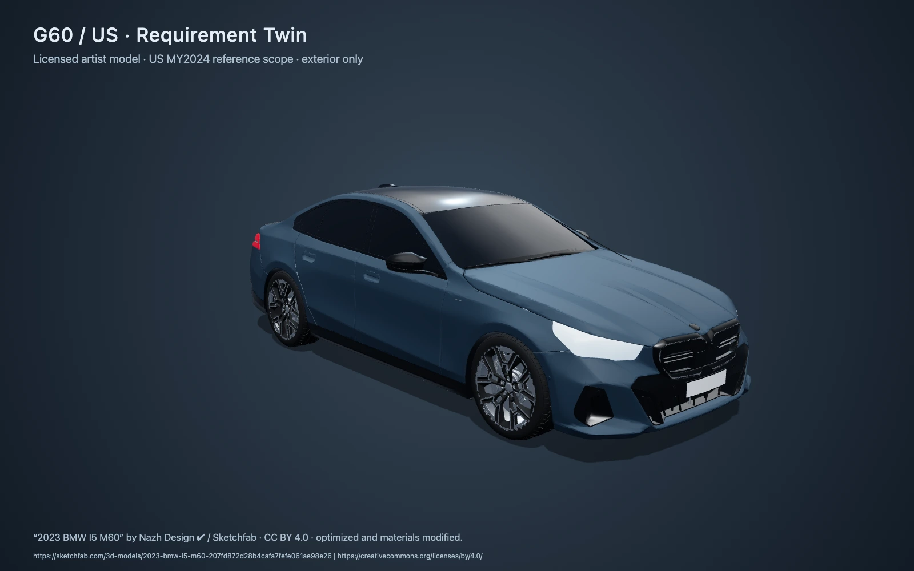
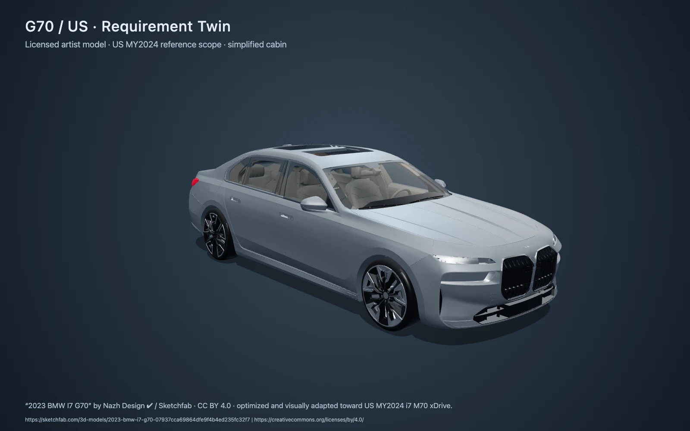

# BMW Requirement Twin vehicle assets

**Ready for integration: G60 / US i5 M60 and G70 / US i7 M70 xDrive visualisation.**

The [package manifest](g60-us/manifest.json) describes the actual GLB, provenance, CC BY 4.0 attribution, 11 stable anchors, 5 camera presets, material overrides and SHA-256. Start with the [integration note](g60-us/INTEGRATION.md) for exact loading paths and real API topic/trace mapping. [index.json](index.json) now includes both vehicles and keeps G60 as the default. Each entry resolves its own manifest and vehicle/market scope.

The 3.04 MB self-contained GLB retains 997,637 triangles with Draco compression. It was downloaded normally after the user signed in, then cleaned and optimized. It is an accurate independent artist's BMW exterior model, **not BMW-supplied CAD**. The creator calls it “2023”; US MY2024 is the official reference scope. Cabin, battery and cargo hotspots are marked approximate because there is no usable interior geometry. Some source panel faceting and simplified lamp shapes remain.

[2023 BMW I5 M60](https://sketchfab.com/3d-models/2023-bmw-i5-m60-207fd872d28b4cafa7fefe061ae98e26) by [Nazh Design ✔](https://sketchfab.com/NazhDesign), [CC BY 4.0](https://creativecommons.org/licenses/by/4.0/). Optimized geometry, materials and anchors modified. Keep the linked credit visible in the UI footer and distribute [LICENSE.txt](g60-us/LICENSE.txt) with the model.

The [verification record](verification.json) covers the actual GLB's browser loading, charging target, cameras, linked attribution, fallback and measured laptop performance. The [developer acceptance viewer](tools/README.md) exercises the live requirements → source evidence → score → PM decision → audit flow. The running test API contained explicitly labelled synthetic records; no feedback, scores or decisions are bundled. Official product facts stay in a separately cited file with market and model year on every fact.

No Troy frontend files, API, database or shared plans were changed. The package was built in its own worktree/branch. Raw downloads and the rejected stylised prototype stay outside Git. This is a loadable handoff, not a claim that Troy has already loaded the asset in his frontend. The [research log](research/README.md) records the licence review, organizer request, official references and remote-branch checks.

## BMW i7 / G70

The second package is in [g70-us/](g70-us/INTEGRATION.md): **0.87 MB, 204,072 triangles**, simplified cabin geometry, 11 anchors, six camera presets including a rear-badge view, poster, schematic, licence and cited US MY2024 M70 reference facts. The [manifest](g70-us/manifest.json) is the loading contract and includes the exact SHA-256; [verification](g70-us/verification.json) records browser acceptance. Author-built `i7` and `M70 xDrive` rear lettering and dark wheel faces add M70 distinction. Source panel faceting and coarse interior/lamp surfaces remain; the fascia, wheel design and diffuser are not exact M70 geometry. It is a licensed artist model, not BMW-supplied CAD.

[2023 BMW I7 G70](https://sketchfab.com/3d-models/2023-bmw-i7-g70-07937cca69864dfe9f4b4ed235fc32f7) by [Nazh Design ✔](https://sketchfab.com/NazhDesign), [CC BY 4.0](https://creativecommons.org/licenses/by/4.0/). Optimized and visually adapted toward US MY2024 i7 M70 xDrive; details are illustrative. Keep this linked credit visible and include [LICENSE.txt](g70-us/LICENSE.txt).

The i7 was originally added on `codex/g70-vehicle-asset` from Troy's committed frontend merge. This M70 visual update stays under `assets/vehicles/`; the G60 GLB remains byte-for-byte unchanged. The developer viewer can select either catalog entry and switch both vehicles between tinted and untinted window appearances without modifying Troy's frontend or dependency files. G70 requests use G70/US exclusively; the current test API has no G70 requirements, so no G70 evidence trace is claimed. See the [source/licence record](research/g70-candidate.json).

Current organizer guidance (recorded in Troy's `f4c46f1`) says BMW has no 3D pack and provides a third-party collection as another source. Each model's own licence applies; both supplied assets use their artist-offered CC BY 4.0. See the [updated research log](research/README.md). This supersedes earlier organizer-response status in the original G60 delivery record.
