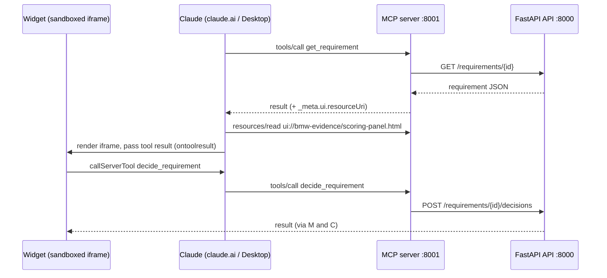

# MCP Apps: interactive widgets for the MCP server

Owner: Alex. Status: ready to implement.

## Goal

Add interactive widgets to the BMW Product Evidence MCP server (`mcp_server/main.py`) so a PM can review, score and decide requirements in a UI inside Claude, without typing tool arguments.

We use **MCP Apps**, the official MCP extension for interactive UI. Claude renders it in claude.ai and the Claude Desktop chat. The MCP server stays a thin adapter over the FastAPI API: widgets call existing MCP tools, so validation, business rules and the audit chain stay in the API and database.

Scope for the first pass: two widgets, the **scoring and decision panel** and the **trace explorer**. Everything else waits until those two work end to end in claude.ai.

## How MCP Apps works

A tool points to an HTML resource. When Claude calls that tool, it renders the HTML inline in a sandboxed iframe and lets it call our other tools.



1. Claude calls `get_requirement` and gets the requirement JSON back.
2. The tool's `_meta.ui.resourceUri` points to `ui://bmw-evidence/scoring-panel.html`. Claude reads that resource and renders it in a sandboxed iframe.
3. Claude passes the tool result into the widget (`app.ontoolresult`).
4. The PM moves sliders, writes a rationale and clicks Approve. The widget calls `app.callServerTool(...)` for `decide_requirement`.
5. Claude forwards the call to the MCP server, which calls the API. The result goes back to the widget the same way.

The widget never talks to the API directly.

## Server changes

The pinned SDK (`mcp==2.3.0`, `MCPServer`) already supports everything needed: `tool()` takes `meta=`, and `resource()` takes `mime_type=` and `meta=`. No new Python dependency.

Add one resource per widget and link the existing tool to it:

```python
from pathlib import Path

UI_DIR = Path(__file__).parent / "ui" / "dist"
APP_MIME = "text/html;profile=mcp-app"
SCORING_UI = "ui://bmw-evidence/scoring-panel.html"
TRACE_UI = "ui://bmw-evidence/trace-explorer.html"


@mcp.resource(SCORING_UI, name="Scoring and decision panel", mime_type=APP_MIME)
def scoring_panel_view() -> str:
    return (UI_DIR / "scoring-panel.html").read_text()


@mcp.resource(TRACE_UI, name="Requirement trace explorer", mime_type=APP_MIME)
def trace_explorer_view() -> str:
    return (UI_DIR / "trace-explorer.html").read_text()


@mcp.tool(meta={"ui": {"resourceUri": TRACE_UI}})
async def trace_requirement(...):  # body unchanged
    ...


@mcp.tool(meta={"ui": {"resourceUri": SCORING_UI}})
async def get_requirement(requirement_id: str) -> dict:  # body unchanged
    ...
```

Rules:

- **Keep tool return values unchanged.** The returned dict is what the widget receives, and clients without UI support (Claude Code, other MCP clients) still use it as text.
- **No business logic in the MCP layer.** If a widget needs data the API doesn't return, add it to the FastAPI endpoint first.
- **`WorkflowMCPServer.call_tool` still applies.** Widget calls go through the same unknown-argument check, so widgets must send exactly the tool's declared arguments.
- **Ship the built HTML in the image.** `mcp_server/Dockerfile` copies `mcp_server/`, so either commit the build step into a Node stage or copy `mcp_server/ui/dist/` in. The resource handler should fail loudly if the file is missing.

## Building the widgets

Each widget must be **one self-contained HTML file** with JS and CSS inlined, because Claude loads it as a single resource. Use Vite with `vite-plugin-singlefile`.

```
mcp_server/ui/
  package.json        # vite, vite-plugin-singlefile, @modelcontextprotocol/ext-apps, typescript
  vite.config.ts      # one entry per widget, output to dist/
  scoring-panel.html
  trace-explorer.html
  src/
    scoring-panel.ts
    trace-explorer.ts
    shared/api.ts     # typed wrappers around app.callServerTool
  dist/               # build output, gitignored
```

The view side uses the `App` class from `@modelcontextprotocol/ext-apps`:

```ts
import { App } from "@modelcontextprotocol/ext-apps";

const app = new App({ name: "Scoring panel", version: "0.1.0" });

// Data from the tool call that opened this widget
app.ontoolresult = (result) => {
  const requirement = result.structuredContent ?? JSON.parse(result.content[0].text);
  render(requirement);
};

// Calls go host -> MCP server -> FastAPI. No CORS or direct network access needed.
async function decide(action: "approve" | "reject" | "postpone" | "challenge", actor: string, rationale: string) {
  const res = await app.callServerTool({
    name: "decide_requirement",
    arguments: { requirement_id, version_id, score_id, action, actor, rationale },
  });
  if (res.isError) showError(res.content[0].text); // stale IDs -> reload and re-render
}

await app.connect();
```

Other `App` methods worth knowing:

- `app.updateModelContext(...)` tells Claude what the user did in the widget, so its next reply knows about the decision.
- `app.sendMessage(...)` posts a message into the chat for the user. Use it sparingly.
- The host passes theme variables; use them so the widget matches light and dark mode.

## First widgets

Both widgets use only tools that already exist in `mcp_server/main.py`.

| Widget | Opened by | Shows | Calls from the widget |
| --- | --- | --- | --- |
| Scoring and decision panel | `get_requirement` | Key, statement, acceptance criteria, the five factor scores (0–5), weights, current priority score, version ID and score ID | `score_requirement` (new weights), `edit_requirement` (new factors), `decide_requirement` (approve, reject, postpone, challenge) |
| Trace explorer | `trace_requirement` | Requirement version → findings → evidence (exact source text and sheet/row location) → sources, plus scores and decisions | `get_finding`, `get_evidence`, `get_source`, `get_requirement_versions`, `list_audit` |

**Scoring and decision panel**

- Sliders for the five factors (customer impact, market relevance, strategic fit, differentiation, feasibility) and the five weights. Show the weighted score live as sliders move. Block submit unless the weights sum to 1.0.
- Every write needs a non-empty rationale.
- Always send the current `version_id` and `score_id`. If the API rejects them as stale, reload with `get_requirement` and tell the user what changed. Never retry silently.
- After a decision, call `app.updateModelContext` with the action and rationale.

**Trace explorer**

- Show the chain as a collapsible tree, newest version first.
- Clicking evidence shows its exact quoted text and location, so the PM can check the source without leaving Claude.
- Use `limit` and `offset` for paging; don't load the whole trace at once.

## Database rules the widgets must respect

From the database governance merge (`40068e3`). Details in `database/README.md` and `notes/database-contract.md`.

- **Show the requirement key.** Each requirement has a readable key, `REQ-<VEHICLE>-<MARKET>-<NNN>` (for example `REQ-G60-US-001`), assigned by the database. Use it as the main label; keep UUIDs for tool arguments only.
- **Decisions need a human actor.** The database refuses decisions from AI or system actors (`AI:openai`, `System:reference`). The decision form must send the PM's own name, never a model or system identity. Claude must not approve on its own behalf.
- **New actors are registered automatically.** An unknown free-text actor becomes a discovered human with role `pm`. Validate the actor field so typos don't create extra people.
- **Read views can back the widgets.** `v_requirement_list`, `v_requirement_trace`, `v_audit_timeline`, `v_topic_markets` and `v_open_reviews` (columns in `notes/database-contract.md` section 5). If the trace explorer needs fields the current `/requirements/{id}/trace` endpoint lacks, expose the view through the API first.
- **Verify the audit chain after testing** with `python -m database.cli verify`.

## Testing and connecting to Claude

claude.ai can't reach `localhost`, so the MCP server needs a public HTTPS URL. It already runs streamable HTTP on port 8001, which is what claude.ai connectors expect.

1. Build the widgets: `cd mcp_server/ui && npm install && npm run build`.
2. Start the stack: `docker compose up -d`. Check that the `mcp` service is healthy in `docker compose ps` and its logs.
3. Open a tunnel: `cloudflared tunnel --url http://localhost:8001` (or ngrok). Copy the HTTPS URL.
4. In claude.ai, go to Settings → Connectors → Add custom connector, and paste the tunnel URL with the MCP path (`/mcp`).
5. In a new chat, ask Claude to show or trace a requirement. The widget should render inline.

For faster iteration, test in a local MCP Apps host first (the `ext-apps` repo has a basic host example). Add a pytest next to `tests/test_mcp.py` that lists resources and tools and asserts each UI tool's `resourceUri` resolves to a resource with the `mcp-app` MIME type.

## Constraints and gotchas

- **Check against the current spec first.** Field names here (`_meta.ui.resourceUri`, `text/html;profile=mcp-app`, `App`, `callServerTool`, `ontoolresult`) were written from memory. Confirm them in the [`modelcontextprotocol/ext-apps`](https://github.com/modelcontextprotocol/ext-apps) repo and its examples before writing code.
- **The sandbox blocks network access by default.** Route all data through `callServerTool`. Only declare extra domains in the resource's `_meta.ui.csp` if truly needed; external CDNs won't load otherwise.
- **Only claude.ai and Claude Desktop chat render widgets.** Claude Code and other clients show the plain tool result, so the text output must stay useful on its own.
- **Widget-only tools.** Tools only the widget should call can be hidden from the model with `_meta.ui.visibility: ["app"]`. Not needed yet.
- **The tunnel URL is public and the MCP server has no auth.** Only keep the tunnel open while testing, and use sample data, not the BMW files in `data/`.
- **Repo rules from `AGENTS.md` apply.** Work on a fresh `codex/mcp-apps` branch from `main`, coordinate `compose.yml` and Dockerfile changes, and keep `dist/` and `node_modules/` out of Git.

## Checklist

Done means both widgets work end to end in claude.ai against the Docker Compose stack, a decision made in the widget shows up in `list_audit`, and `python -m database.cli verify` passes.

- [ ] Confirm the spec details in the `ext-apps` repo
- [ ] Create branch `codex/mcp-apps` from the latest `main`
- [ ] Scaffold `mcp_server/ui/` with Vite and `vite-plugin-singlefile`; gitignore `dist/` and `node_modules/`
- [ ] Register both UI resources and add `meta` to `get_requirement` and `trace_requirement`
- [ ] Build the scoring and decision panel, with the `REQ-…` key, human-actor validation and stale-ID handling
- [ ] Build the trace explorer with paging
- [ ] Update `mcp_server/Dockerfile` to include the built HTML
- [ ] Add a pytest that checks each `resourceUri` resolves to an `mcp-app` resource
- [ ] Test through a tunnel in claude.ai; record a decision and confirm it in `list_audit`
- [ ] Run `python -m database.cli verify`
- [ ] Document setup in `notes/mcp-api.md`
