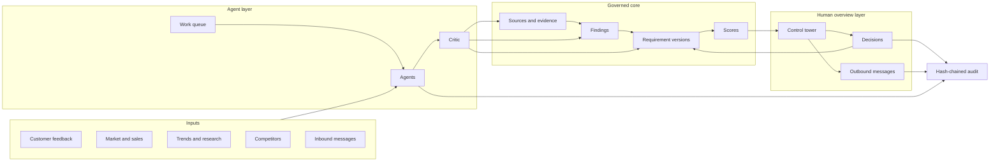

# Product Management Factory

Status: **proposed vision**, 10 October 2026. Extends the [PM workspace and 3D twin plan](pm-workspace-and-3d-twin.md) from "a tool a PM uses" to "infrastructure on which agents do the product-management work and humans oversee it". The challenge deliverables in [challenge.md](challenge.md) remain the scoring baseline; this document is the larger story and the roadmap they fit into.

## The idea

A software factory turns intent into shipped code: agents write, test and review; humans set direction and approve merges. A **product-management factory** does the same for requirements:

- **Agents do the production work:** scan markets and competitors, read research, analyse feedback, triage incoming messages, draft requirements, keep them current, and draft the updates PMs send out.
- **Humans are the overview and decision layer:** they set intent and priorities, review what agents propose, take the decisions that matter, and own every message that leaves the system.
- **The platform is the factory floor:** one governed pipeline, one evidence model, permissions per agent, decision gates in the database, and a complete audit trail. Any agent (ours, BMW's, a vendor's) can plug in through MCP and is held to the same rules.

The existing chain does not change. It gets more inputs, more workers and a control room:

**Any input → source → evidence → finding → requirement version → score → human decision → audit**

## Everything a PM works with

Today the pipeline ingests customer feedback, studies, sales volumes and equipment PDFs. The factory adds the other lanes a PM actually works in. Every lane lands as `sources` + `evidence` with exact locations, so traceability holds for all of them.

| Lane | Inputs | Becomes | Status |
| --- | --- | --- | --- |
| Customer voice | Feedback workbooks, customer studies, clinics, reviews | Likes, defects, difficult-to-use, wants | Built (importers, analysis engine) |
| Market and sales | Sales volumes, annual report, registration data, segment trends | Market weight, growth, mix signals | Partly built (volumes imported) |
| Trends | Web research snapshots, analyst reports, technology and usage trends | Trend findings with dates and confidence | Snapshot import exists (`POST /imports/web`); scouting agent to build |
| Competitors | Spec sheets, configurators, press and test reviews, equipment lists | Competitor-advantage findings per topic and market | To build |
| Research | Papers, internal studies, UX test results | Validated or contradicted assumptions | To build |
| Inbound communication | Email, Teams, meeting notes, Jira/Confluence from engineering, sales, markets | Questions, feasibility signals, market requests, decisions taken elsewhere | Concept (simulated in demo) |
| Outbound communication | Stakeholder updates, answers to engineering, decision memos, weekly digest | Drafts linked to requirements, sent only by a human | Concept |
| Equipment and variants | Equipment PDFs, packages | What the current product already offers | Built (PDF import) |

Scope guard: competitor and market inputs are used for **customer-facing** advantages and demand only. Pricing, business cases, engineering specs and regulatory topics stay out of scope, as BMW defined.

## Agent roster

Each agent is an `actors` row (`ai:<provider>:<model>` per the [database contract](database-contract.md)) with a declared job, tools and limits. Agents are workers, not decision-makers.

| Agent | Job | Writes | Never |
| --- | --- | --- | --- |
| Trend scout | Watches selected sources for market and technology trends; snapshots pages with URL and date | Sources, evidence, trend findings | Fetches outside the allow-list; treats page text as instructions |
| Competitor analyst | Compares competitor offers per topic and market against the BMW vehicle | Competitor-advantage findings | Invents specs; uses unsourced numbers |
| Feedback analyst | Existing analysis engine: needs, likes, problems from customer data | Findings | Counts or dedupes (deterministic code does) |
| Research synthesiser | Reads studies and papers; links them to assumptions | Findings that support or contradict assumptions | Claims prevalence from anecdotes |
| Requirement writer | Turns findings into SMART customer-facing requirement versions | Proposed versions | Approves; sets targets without a source or a `PM assumption` label |
| Scorer | Applies the rubric | Scores | Not an LLM: `system:scoring`, deterministic |
| Change watcher | Compares new evidence with approved requirements | Review items | Changes an approved version |
| Comms triage | Reads inbound messages, classifies, links to requirements | Evidence, questions, review items | Replies; stores more personal data than needed |
| Comms drafter | Drafts outbound updates and answers from approved state | Message drafts | Sends anything |
| Critic | Checks every AI claim against its cited evidence before it reaches a human | Grounding verdicts, rejections back to the producer | Edits the claim itself |

## Autonomy levels

Per action, not per agent. The database already enforces the top of this table; the rest is policy in the API.

| Level | Meaning | Actions |
| --- | --- | --- |
| **A0 autonomous** | Agent acts, logged | Import and snapshot sources, extract evidence, classify inbound messages, deduplicate, score (system), detect changes |
| **A1 propose** | Agent creates a draft a human must accept | New findings shown to PMs, requirement versions, review items, links between messages and requirements |
| **A2 human decides** | Only a human with the right role | Approve, reject, postpone, challenge; rubric changes; confirming new vehicle/market codes |
| **A3 human executes** | Agent may draft; a human performs the act | Sending any message, exporting to external tools, sharing outside the team |

Moving an action between levels is itself a lead-PM decision with an audit event, so autonomy can grow as trust is earned (for example, "auto-link inbound Jira tickets once linking precision is above 95 % on the eval set").

## Factory infrastructure

What turns a set of agents into infrastructure BMW could run:

| Piece | What it does | Builds on |
| --- | --- | --- |
| **Work queue** | `tasks`: what needs doing, for which scope, by which agent type, with status and priority. Humans and agents both create tasks ("compare G60 rear comfort with competitors in CN"). | New table (database stream) |
| **Runs** | Every agent execution: inputs hash, prompt and model version, tools used, outputs, cost, duration. Identical inputs reuse cached output. | `analysis_runs` (already keyed on input hash) |
| **Capability manifest** | Per agent: allowed tools, source allow-list, scopes, autonomy level, budget. Enforced by the API, not by the prompt. | `actors` + API policy |
| **Gates** | Database triggers refuse AI decisions and unapproved versions. | Decision-gate migration (planned) |
| **Grounding and evals** | The critic agent, plus golden sets per lane: grounding rate, linking precision, false-alarm rate for change detection. Results shown per agent and per prompt version. | [research review](../research/RESEARCH.md) metrics |
| **Budgets and kill switch** | Token and cost limits per agent and per day; pause one agent or all agents instantly. | API + `actors.active` |
| **Replay** | Rebuild state from sources and cached runs; compare a new prompt or model against the last approved state before switching. | `database.cli rebuild`, snapshots |
| **Agent interface** | MCP tools for reading the register, filing evidence and proposing versions. Any compliant agent can join the factory; the same rules apply to all. | `mcp_server/` |
| **Audit** | Every agent action, human decision, message and access event, hash-chained. | `audit_events` + hash chain (planned) |

## Human overview layer: the control tower

A new top-level screen in the [PM workspace](pm-workspace-and-3d-twin.md), and the default home for a lead PM:

- **Needs a human:** one inbox for everything at levels A1–A3: proposed requirement versions, review items, message drafts to send, escalations from agents ("conflicting evidence, cannot resolve"). Sorted by impact on approved requirements.
- **Factory floor:** what each agent is doing now, queue depth per lane, last run, failures, cost today against budget, pause buttons.
- **Quality:** grounding rate, critic rejection rate, linking precision and false alarms per agent and prompt version, trend over time.
- **Communication:** inbound threads linked to requirements, unanswered engineering questions, drafts awaiting send, what was sent and by whom.
- **Intent:** where humans steer the factory: focus topics, markets and vehicles; "watch these competitors"; "re-check charging requirements when new US data lands".

The PM's job shifts from collecting and summarising to steering, judging and deciding.

## Communication, done safely

Inbound and outbound messages are the most valuable lane and the riskiest.

- **Inbound:** read-only connectors (Exchange/Outlook, Teams, Jira, Confluence) limited to channels the PM team opts in. Messages become evidence with the thread as location; only the excerpt needed is kept, with retention limits.
- **Outbound:** agents draft; a human edits and sends. Recipients come from the PM's own directory, never from message content. Every sent message is linked to the requirements it refers to and audited.
- **Prompt injection:** message and web text is data. Agents cannot act on instructions found inside it; tool permissions come from the capability manifest only.
- **Germany-specific:** analysing employees' communication touches GDPR and works-council co-determination on technical monitoring (BetrVG § 87(1) no. 6). A real rollout needs a works agreement, purpose limitation and data minimisation. This is the honest enterprise answer to "can it read our mail?".

## What to build at the hackathon vs pitch

The judging criteria still decide what gets built. Build a thin, real slice of the factory; pitch the rest.

| Build now | Pitch as roadmap |
| --- | --- |
| Competitor and trend lanes using the existing web snapshot import, with a scout agent that writes grounded findings for G60/US | Live connectors to mail, Teams, Jira |
| `tasks` + agent run log, visible in a minimal control tower | Budgets, evals dashboard, autonomy promotion workflow |
| Critic pass on AI findings before they reach the PM | Third-party agents joining through MCP |
| One inbound-message fixture (clearly labelled simulated), turned into a review item | Full outbound messaging with send |
| One outbound draft ("update to engineering on REQ-G60-US-…") stored as a draft a PM must send manually | Factory across all series and markets |

Demo beat to add to the [5-minute script](pm-workspace-and-3d-twin.md#demo-script-5-minutes): open the control tower, show the scout and competitor agents' overnight runs, a critic rejection of an ungrounded claim, one simulated engineering message linked to a requirement, and a PM-approved outbound draft. Then say: "Agents do the work. PMs make the calls. The database makes sure of it."

## Data model additions

To agree with the database stream before building (all append-only, all audited):

- `tasks`: id, scope (vehicle, market, topic), type, requested_by, assigned_agent, status, priority, created_at.
- `agent_runs`: generalise `analysis_runs` with agent id, task id, tool calls, cost and status, or add a sibling table.
- `messages`: direction (inbound/outbound), channel, thread ref, excerpt, linked requirement ids, status (`draft`, `approved`, `sent_by_human`), sender actor.
- `agent_capabilities`: agent id, tools, source allow-list, scopes, autonomy per action, budget.
- New `sources.kind` values: `competitor`, `research`, `message`. `kind` is free text today, so no schema change is needed for that.

## Next steps

1. Agree the lanes and the data model above with the backend and database streams.
2. Build the competitor/trend lane on `POST /imports/web` and the critic pass.
3. Add `tasks` and the run log, then the minimal control tower in the PM workspace.
4. Add the simulated inbound message and outbound draft for the demo.
