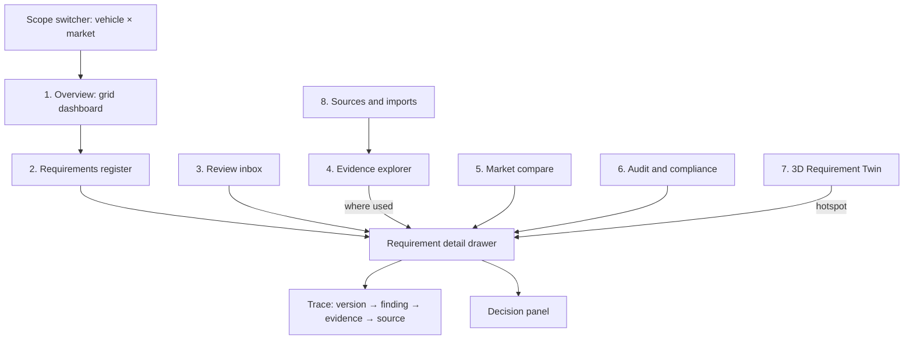
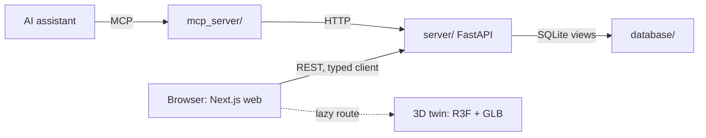

# PM workspace and 3D Requirement Twin

Status: **proposed**, 10 October 2026. This plans component 6 of the [implementation plan](../IMPLEMENTATION_PLAN.md), the PM workspace, and the 3D layer from the [archived demo proposal](winning-demo-proposal.md). Nothing here changes the backend chain or the [database contract](database-contract.md); the UI only reads the contract's views through the API and writes decisions through it.

The wider vision, agents doing the PM work across all inputs with humans as the overview layer, is in the [Product Management Factory](pm-factory.md).

## Positioning

Other teams will show a chatbot that writes a requirement list. We show **the system a BMW product-management organisation would actually run for two years**: a governed register of requirements where every number opens its evidence, every decision has an owner, and the database itself refuses an AI approval.

The 3D car is the closing moment, not the product. It works only because it sits on top of a traceable register: a judge clicks the seat on the car and lands on the original customer feedback row, its score, the PM's decision and the audit event in a few seconds.

Three claims the UI has to make visible:

1. **Enterprise-ready.** It looks and behaves like internal BMW tooling (dense, calm, keyboard-driven, role-aware) and plugs into what BMW already runs: OpenAPI, MCP, SSO, exports to requirements tools.
2. **Traceable by construction.** No score, count or claim appears without a click-through to its source. Every screen state is a shareable URL.
3. **Honest.** Sample counts are never shown as market share, weak evidence looks weak even with a high score, and PM assumptions are labelled as such.

## Design language

"shadcn/ui with improved glass, corporate" in concrete terms:

| Decision | Choice | Why |
| --- | --- | --- |
| Components | [shadcn/ui](https://ui.shadcn.com) on Radix, Tailwind CSS v4 tokens | Accessible primitives, code we own, consistent with modern enterprise consoles (Linear, Vercel, Palantir-style ops tools). |
| Surfaces | Opaque neutral surfaces for all data (tables, trace, diffs). **Glass** (`backdrop-blur`, 1px light border, low-alpha fill) only on floating layers: command palette, drawers, toasts, 3D HUD | Glass on dense tables hurts legibility. Used sparingly it reads premium; everywhere it reads like a template. |
| Colour | Zinc/graphite neutrals, one blue accent, semantic colours reserved for status and evidence grade | Corporate and calm. Colour carries meaning, not decoration. |
| Type | Inter or Geist, tabular numerals in grids | BMW Type Next is proprietary; do not ship it. |
| Themes | Light and dark, compact/comfortable density toggle | PMs live in this tool all day; engineering viewers often prefer dense. |
| Motion | 150–200 ms transitions, no decorative animation outside the 3D view and the overview | Enterprise tools feel fast, not lively. |
| Accessibility | WCAG 2.2 AA, full keyboard navigation, visible focus | Required for any real BMW rollout; also judged under usability. |
| Brand | Neutral product name ("Requirement Twin"), no BMW logo unless BMW confirms it is allowed | Avoid implying an official BMW product. |

Encoding rules that every screen follows:

- **Score and evidence grade always appear together.** A score bar with grade A–B is solid; with grade C–D it is outlined/hatched, so a high score on weak evidence looks different at a glance.
- **Counts say what they count**: "38 feedback IDs in sample", never "38 % of customers". The G60/US data limit (72.7 % of US feedback IDs come from Source B) is a persistent banner on the scope, not a footnote.
- **Provenance on hover, trace on click.** Any number opens a popover with its derivation; clicking opens the full trace.
- **AI content is marked.** Text written by an `ai:*` actor carries an AI badge until a human edits or approves it.

## Information architecture

A persistent shell holds the scope switcher (`G60 · US`), global search, a **⌘K command palette** (jump to `REQ-G60-US-004`, "show needs review", "export approved"), the signed-in actor and role, and a Needs-review counter.

URLs carry all state, so a PM can paste a link into Teams and the recipient sees the same filtered view: `/g60/us/requirements?status=needs_review&sort=-score`, `/g60/us/requirements/REQ-G60-US-004/trace`.

### 1. Overview (grid dashboard)

A bento grid of widgets on [react-grid-layout](https://github.com/react-grid-layout/react-grid-layout); each user can rearrange and the layout persists per user (browser storage first, server later). Default widgets:

| Widget | Source | Answers |
| --- | --- | --- |
| Status KPIs: proposed / approved / needs review / postponed / rejected | `v_requirement_list` | Where is the portfolio? |
| Priority vs evidence matrix (score on Y, evidence grade on X, bubble = source count) | `v_requirement_list` | Which priorities rest on weak evidence? |
| Loves to preserve vs pains to fix | findings by kind | Are we protecting what customers like? |
| Cross-market topic heatmap (topic × US/CN/EU) | `v_topic_markets` | Where do markets disagree? |
| Recent decisions | `v_audit_timeline` | Who decided what, and why? |
| Data coverage and limits | imports, sources | What is the sample, and what can it not tell us? |
| 3D twin thumbnail (P2) | zone roll-up | Where on the car is the pressure? |

Every tile click-throughs to a filtered register or trace.

### 2. Requirements register (data grid)

The deliverable list as a working tool. TanStack Table with virtualisation (shadcn data-table pattern): column pinning (key, title), sorting, multi-filter, saved views, density, CSV/JSON/ReqIF export. Columns come straight from `v_requirement_list`: key, title, topic, status, score and rank, evidence grade, finding/evidence/source counts, open reviews, last decision (actor, action, time).

No bulk approve. Approval is a per-requirement human gate by design, and the UI says so.

### 3. Requirement detail (drawer, also full page)

Header: key, version, status, score bar with grade, AI/human badge. Tabs:

| Tab | Content |
| --- | --- |
| Requirement | Statement, customer need, SMART acceptance criteria, assumptions. Each numeric target shows its origin: a source or `PM assumption`. |
| Evidence | Trace tree from `v_requirement_trace`: finding (supports / conflicts) → evidence span with exact location (sheet, row, page) → source, with "open original". Conflicting evidence is shown, not hidden. |
| Score | Weighted factor breakdown (waterfall), rubric version, evidence-grade inputs (coverage, diversity, consistency, conflict flag). A **what-if** sandbox reweights the rubric client-side and shows the rank change, labelled "simulation, not saved"; saving a new rubric is a lead-PM action with its own audit event. |
| Versions | Approved vs proposed side-by-side diff; why the proposal exists (which new evidence triggered it). |
| History | The requirement's slice of `v_audit_timeline`, with a "chain verified" badge from the audit hash chain. Access events included. |

Decision panel (sticky footer): **Approve, Edit, Reject, Postpone, Challenge**. Rationale is mandatory; Edit creates a new version and re-scores before approval is possible. Buttons a role cannot use are visible but disabled with the reason ("Approval requires role PM"), which demonstrates the gate instead of hiding it.

### 3a. Review inbox

`v_open_reviews` as a triage queue: what changed, why it matters, suggested response, approved vs proposed. Keyboard driven (`j`/`k` move, `o` open, `e` edit, `a` approve with rationale prompt). This is the "ongoing two-year process" in one screen.

### 4. Evidence explorer

Search and filter all evidence by source, kind, market and topic; open the original; **where used** shows every finding and requirement that cites a span (reverse traceability, which also answers "if this source is withdrawn, what is affected?").

### 5. Market compare

`v_topic_markets` side by side for one vehicle: status, score and grade per market, with divergence highlighted. Addresses BMW's stated PM pain point of balancing markets with different climate, usage and culture.

### 6. Audit and compliance

Global timeline with filters (actor, role, action, entity, time), chain verification status, access events, and audit export. An `auditor`/`viewer` role sees this read-only.

### 8. Sources and imports

Import runs, file checksums against the inventory, row counts, discovered vehicle/market codes awaiting confirmation, analysis runs with provider/model/prompt version. Makes the data pipeline inspectable without a database client.

## Roles and usability beyond the PM

The `actors` roles from the [database contract](database-contract.md) drive the UI:

| Role | Default home | Can |
| --- | --- | --- |
| Lead PM | Overview | Everything a PM can, plus rubric changes and confirming discovered codes |
| PM | Review inbox | Approve, reject, edit, postpone, challenge |
| Analyst | Evidence explorer | Challenge, annotate, trigger imports |
| Engineering | Register filtered to approved | Read, export, challenge feasibility |
| Viewer / auditor | Audit | Read only |

Until there is SSO, the actor is picked in the shell (as the API contract already allows). Production path: OIDC against BMW's identity provider, mapping groups to these roles.

## Enterprise integration

What lets BMW adopt it rather than admire it:

| Integration | How | Phase |
| --- | --- | --- |
| API-first | FastAPI OpenAPI → generated TypeScript client (`openapi-typescript`). The UI has no private endpoints; anything the UI does, BMW systems can do. | P0 |
| AI assistants | The existing MCP server exposes the same reads and proposals, so BMW's internal assistants work on the same governed data. AI can propose, never decide. | P0 (exists), extend in P1 |
| Deep links | Stable URLs per requirement key and per view; paste into Teams, Jira, Confluence. | P0 |
| Requirements tools | Export approved requirements as **ReqIF** (the OMG interchange standard read by IBM DOORS, Polarion, Codebeamer, Jama) plus CSV/JSON, each export written as an `access.export` audit event. | P1 |
| Embedding | Register and requirement card buildable as embeddable routes (iframe / micro-frontend) inside an existing BMW portal. | P3 |
| Notifications | Webhook on `review_item` created → Teams/Slack/Jira. | P3 |
| Identity and data | OIDC SSO; Postgres with row-level security per market (the documented path in the [database plan](../database/IMPLEMENTATION_PLAN.md)). | P3 |
| Language | English first, German via i18n keys from the start. | P1 |

## 3D Requirement Twin (north star)

### What it is

A spatial view of the requirement register. The car is divided into **customer-experience zones**; each requirement maps to one or more zones; the zones are coloured by a chosen layer; clicking a zone filters the register and opens the trace. It explains requirements in space. It is **not** engineering geometry, a configurator, or a source of facts.

### Zone model

One shared taxonomy drives both the 2D map and the 3D model, so the 3D work is a rendering of data that already exists:

| Zone | Example topics |
| --- | --- |
| `exterior` | design, paint, lighting signature, quality perception |
| `cockpit` | displays, iDrive, controls, usability |
| `infotainment` | navigation, apps, connectivity, digital services |
| `seats_front` | seat comfort, ergonomics, materials |
| `rear_cabin` | rear space, rear comfort, rear entertainment |
| `charging` | charge port, public charging, route planning |
| `battery_range` | range, range confidence |
| `chassis` | ride, handling, driving dynamics (shown on wheels/suspension) |
| `acoustics` | cabin noise (whole-cabin glow) |
| `cargo` | trunk, storage, practicality |

Mapping `topic → zone` is a deterministic reference table (`topic_zones`, seeded, reviewable by a PM), never an LLM guess at render time. Add it as a migration in the database stream and expose it as `GET /zones` with per-zone roll-ups (requirement count, top score, worst evidence grade, open reviews).

### Rendering

- [React Three Fiber](https://r3f.docs.pmnd.rs) + drei, lazy-loaded on its own route so the register stays fast.
- One stylised sedan GLB, Draco-compressed, under ~5 MB, with a **licence that permits use** (for example a CC-BY model with attribution, or a team-built low-poly). No BMW CAD, no scraped models.
- Hotspots are anchors per zone (drei `<Html>` pins at fixed coordinates), so the model does not need to be segmented. If the GLB has named meshes per zone, also tint them with an emissive material.
- Camera presets per zone with smooth transitions; orbit limited to sensible angles.
- Glass HUD over the canvas: layer switcher, legend, selected-zone card with its top requirements.

### Layers (one active at a time)

| Layer | Encoding |
| --- | --- |
| Priority | Zone intensity by top score in zone |
| Evidence strength | Grade A–D; weak evidence shown hatched/pulsing |
| Status | Approved / proposed / needs review |
| Loves vs pains | Green = attributes to preserve, amber = problems |
| Market delta | US vs CN vs EU difference for the zone's topics |
| Change | Zones touched by the latest evidence batch (the update workflow made visible) |

### The editor (north-star interactions)

"Editor" means editing **requirements** spatially, not geometry:

1. **Pin a proposal.** Drop a pin on a zone → draft requirement prefilled with that zone's topics → normal edit/score/approve flow. The draft is a proposed version like any other.
2. **Intent prompt.** "Make it more luxurious" → the system maps intent to topics (seat comfort, material quality, acoustics, rear experience, digital experience) → affected zones light up → G60 requirements are compared with G70 evidence (the F70/G60/G68/G70 customer study is the benchmark) → proposed deltas appear as drafts for PM decision. Nothing is applied without a human gate.
3. **Compare.** G60 vs G70 ghost overlay, or US vs CN heat, to show where successor requirements should borrow from the 7 Series.
4. **Packages (P3).** Toggle equipment packages from the equipment PDFs to see which requirements a package addresses.
5. **Snapshot for decks.** Export the current view as an image with the requirement keys in the caption.

### Build order for the twin

Step-by-step build, model sourcing and stack: [3D twin implementation plan](3d-twin-plan.md).

2D first, then 3D, both on the same zone data:

1. `topic_zones` table + `GET /zones` roll-up.
2. **2D top-down SVG schematic** with the same zones and layers. Cheap, robust on any laptop and projector, and the fallback if WebGL fails during the pitch.
3. 3D model with hotspots, camera presets, layer switcher, click → register filter → drawer.
4. Compare mode and intent prompt.
5. Packages and pin-to-propose.

## Technical architecture

| Concern | Choice |
| --- | --- |
| App | Next.js (App Router), TypeScript, in a new `web/` folder |
| UI kit | shadcn/ui, Tailwind v4, lucide icons |
| Data | TanStack Query; types generated from the FastAPI OpenAPI schema |
| URL state | `nuqs` for filters, sort, tabs and selected requirement |
| Grid | TanStack Table + TanStack Virtual (AG Grid Enterprise is the production option if BMW already licenses it) |
| Dashboard layout | react-grid-layout |
| Charts | Recharts via shadcn charts |
| Command palette | `cmdk` (shadcn Command) |
| 3D | three, @react-three/fiber, @react-three/drei |
| Mocking | MSW fixtures shaped exactly like the contract views, so UI work does not wait for backend milestones 4–6 |
| Runtime | `web` service in `compose.yml` on `127.0.0.1:${WEB_PORT:-3000}`, `depends_on: api (healthy)`; `WEB_PORT` and the API base URL added to `.env.example` |

### API the UI needs

Thin read endpoints over the agreed views plus the decision writes. These belong to the backend stream (milestones 4–6); the UI builds against fixtures until they land.

| Endpoint | Backed by |
| --- | --- |
| `GET /scopes` | `vehicles`, `markets` |
| `GET /requirements?vehicle&market&status&sort` | `v_requirement_list` |
| `GET /requirements/{key}` (writes `access.requirement.viewed`) | `v_requirement_list` + current version |
| `GET /requirements/{key}/trace` | `v_requirement_trace` |
| `GET /requirements/{key}/history` | `v_audit_timeline` |
| `GET /requirements/{key}/versions/{a}/diff/{b}` | `requirement_versions` |
| `POST /requirements/{key}/versions` | PM edit → new version → re-score |
| `POST /requirements/{key}/decisions` | approve / reject / postpone / challenge, rationale required |
| `GET /reviews` | `v_open_reviews` |
| `GET /topics/markets?vehicle` | `v_topic_markets` |
| `GET /audit` and `GET /audit/verify` | `v_audit_timeline`, hash chain |
| `GET /dashboard/summary?vehicle&market` | aggregates of the views |
| `GET /zones?vehicle&market` | `topic_zones` roll-up |
| `GET /exports/requirements?format=csv\|json\|reqif` | `v_requirement_list`, writes `access.export` |

## Phasing

The event runs 10–11 October 2026, so phases are sized in hours. Each phase ends in a demoable state.

| Phase | Scope | Done when | Effort |
| --- | --- | --- | --- |
| **P0: governed register** | Shell, scope switcher, register grid, detail drawer (requirement, evidence trace, history), decision panel with role gating, fixtures matching the contract | One G60/US requirement goes from register → trace to original row → PM edit → approve, with the audit event visible | 4–6 h |
| **P1: enterprise layer** | Overview grid dashboard, review inbox, market compare, score breakdown with what-if, ⌘K, CSV/JSON/ReqIF export, dark mode | A new evidence batch shows up in the inbox and the overview, and an approved requirement exports to ReqIF | 3–4 h |
| **P2: twin** | `topic_zones`, 2D schematic, then 3D with hotspots, layers and click-through | Clicking the charging port reaches the original public-charging feedback rows in three clicks | 3–5 h |
| **P3: north star (pitch roadmap)** | Pin-to-propose, intent prompt, G60/G70 compare, packages, SSO, Postgres + RLS, Teams/Jira webhooks, embedding | Shown as roadmap slides and, where built, as a short clip | after the hackathon |

Cut order if time runs out: P3 → 3D (keep the 2D map) → what-if → ReqIF → market compare. Never cut the trace, the decision gate or the audit history; those are what the judging criteria score.

## Demo script (5 minutes)

1. **Overview** (`G60 · US`): portfolio status, priority-vs-evidence matrix, the Source B data-limit banner. "We show what the data can and cannot say."
2. **Register** → `REQ-G60-US-…` public charging: score with grade, 38 feedback IDs on public charging and 46 on electric range ([archived proposal](winning-demo-proposal.md)) in sample.
3. **Trace**: finding → exact feedback row → open original. A conflicting finding is visible.
4. **Score**: factor breakdown; what-if shows the rank is robust (or not) to weights.
5. **Decide**: switch to an AI actor → Approve is disabled by the database gate. Switch to PM → edit the acceptance target (marked `PM assumption`) → approve with rationale → audit event with chain verified.
6. **Update**: import a simulated new feedback batch (labelled as simulated, the data has no timestamps) → inbox shows a review item with approved vs proposed.
7. **Twin**: rotate the car, Change layer lights the charging zone, click → back at the original feedback. Close on the north-star editor as roadmap.

## Judging criteria coverage

| Criterion | Where the UI proves it |
| --- | --- |
| Decision and scoring logic | Score breakdown, grade beside every score, what-if robustness, conflicts in the trace |
| Workflow and human decision-making | Role-gated decision panel, review inbox, AI badges, disabled-with-reason actions |
| Traceability and auditability | Click-through from any number, trace tab, history with hash-chain status, access events, deep links |
| Solution quality, usability, feasibility | Enterprise shell, keyboard flow, dark/density modes, exports to DOORS/Polarion via ReqIF, OpenAPI/MCP parity |
| Innovation, scalability, business impact | Scope switcher across vehicles and markets, market compare, 3D twin, two-year update workflow |

## Ownership and next steps

- New stream `codex/web` in its own worktree, owning `web/` only. `compose.yml`, `.env.example` and new API endpoints are shared and coordinated with the backend owner (Jakob) before merging.
- `topic_zones` is a database-stream migration; agree the zone list above first.
- Before building: confirm the API endpoints above with the backend stream, choose and licence-check the GLB, and confirm whether a BMW logo may appear.
